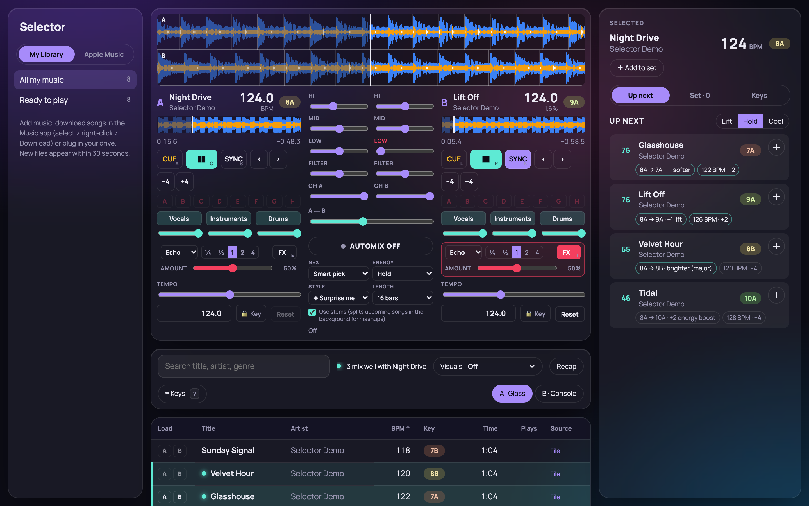
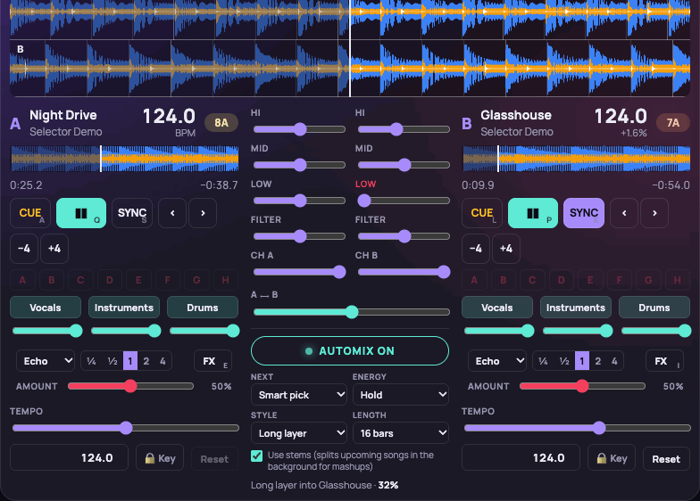
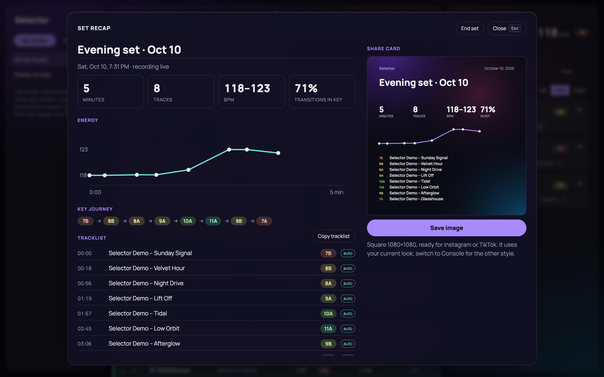
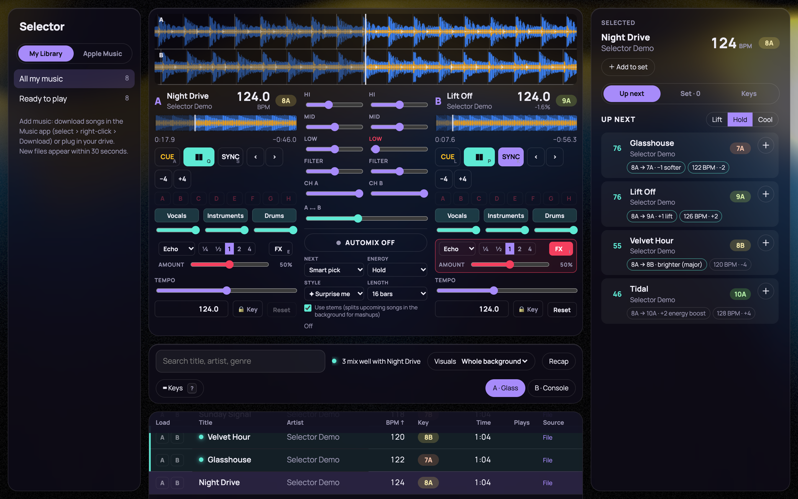
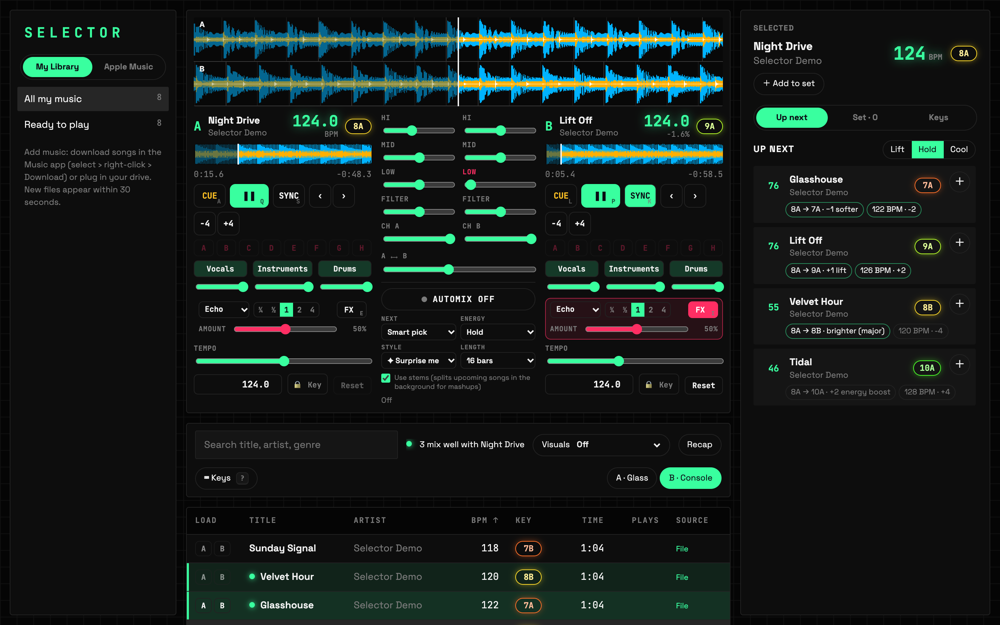

# Selector

A personal DJ app with an AI co-pilot. It suggests the next track and explains why, automixes on the phrase with transitions that move many controls at once, splits songs into vocals / instruments / drums on-device, and drives WebGPU visuals from the beat.





*All audio in these images is original demo material generated by `scripts/make-demo.mjs`. No real music is in this repo.*

## Why I built it

I DJ on a Pioneer DDJ-SR with rekordbox. I wanted three things rekordbox doesn't give me: suggestions that explain themselves, an automix that actually *mixes*, and an interface I enjoy looking at. I come from marketing, not engineering, so I built this with [Claude Code](https://claude.com/claude-code) as my pair programmer. I made the product calls, tested every feature by ear and by measurement, and decided what shipped. The concepts behind each piece are written up in my [Trainer's Handbook](https://noahchen.vercel.app/handbook/).

## What it does

| | |
|---|---|
| **Library** | Reads a rekordbox XML export (BPM, Camelot key, beatgrid, cue points, playlists) and the Music app's library export (playlists matched to tracks by artist + title). Scans folders of your own audio files. |
| **Suggestions** | Ranks what to play next and shows the reasons ("8A → 9A · +1 lift · 126 BPM · +2 · also in House Grooves"). Lift / Hold / Cool steers the energy. Tracks that mix with the selected one light up in the list. |
| **Two decks** | Three-band waveforms with beatgrids, EQ with kills, filter, faders, equal-power crossfader, beat-aligned sync (half/double-time aware), cues, beat jumps, nudge, keyboard control, drag-and-drop loading. |
| **Automix** | Picks the next track, preloads it, matches tempo, and starts the blend on an 8-bar phrase. Seven transition recipes (Long layer, Three-band swap, Filter swap, Echo out, Stem mashup, Blend, Cut) or **Surprise me**. If the only track left clashes in key, it echoes the old one out so the two never sound together. |
| **Stems** | Splits a song into vocals, drums, bass and other with Demucs on the Mac's GPU, cached per track. Each deck gets Vocals / Instruments / Drums controls. |
| **Live FX** | Echo, Reverb, Phaser, Flanger, Trans and Wah per deck, synced to the deck's tempo. |
| **Key lock** | Change tempo without changing pitch (a WSOLA time-stretcher on the audio thread). |
| **Visuals** | Shader scenes that pulse on the beat, take their palette from the track's key, and follow loudness. Shown behind the decks, as the whole background, or in a separate window for a second screen. |
| **Set recap** | Logs what was actually audible: a track counts after 20 seconds of being clearly heard, even while sharing the mix during a long blend. Shows stats, an energy curve, the key journey, a copyable timestamped tracklist, and a 1080×1080 share card. |
| **Hand-off** | Sends a set to rekordbox as a separate playlist file, so rekordbox's Automix can play streaming tracks Selector can't. |

<p>
  
  
</p>
<p>
  
  
</p>

The recap above is from a real five-minute automix set over the eight demo tracks. It also shows an honest limitation: with only eight songs, automix ran out of good matches for the last two transitions (71% in key). That's what prompted the echo-out rule for clashes.

## How the "smart" parts work

**Explainable next-track ranking (on-device, no model calls).** Each candidate passes two hard checks: a compatible key move on the Camelot wheel (same key, ±1, relative major/minor, or +2 for an energy boost) and a tempo within 8%, counting half and double time. Survivors are scored:

| Signal | Weight | Notes |
|---|---|---|
| Key move | 35 | Same key 1.0, ±1 0.9, relative 0.85, +2 0.6 |
| Tempo | 25 | Linear falloff to the 8% limit |
| Direction | 25 | Does it lift, hold or cool the energy as asked? |
| Vibe | 15 | Same genre, and playlists both songs share |

Each signal produces a human-readable reason. Streaming audio can't be analysed, so "vibe" comes from metadata and from the DJ's own playlists: songs grouped together go together. A unit test caught an early weighting where a same-genre track that *raised* the energy beat a cooling track in "Cool" mode, so direction now outweighs vibe.

**Automix as data, scheduled on the audio clock.** A transition is a recipe: a list of timed moves (control, from, to, start, duration) for both decks plus a crossfader path. The planner finds the last 32-beat phrase that lets the blend finish two bars before the outgoing track ends, then every move is scheduled with Web Audio automation. That makes timing sample-accurate even in a background tab. Measured beat drift through a 16-bar blend: **0.00 ms**.

**Stems on-device.** `server/stems.py` runs Demucs (`htdemucs`) through PyTorch's Metal backend and writes lossless FLAC stems. Checked: stems sum back to the original within 2.6%, with a **0-sample** offset, so they can replace the full mix mid-song without a hiccup. A 64-second test track splits in about 11 seconds on an M3.

**Key lock.** `public/stretch-worklet.js` is a WSOLA time-stretcher: Hann-windowed slices at 50% overlap, each nudged to where its waveform best continues the last, with a normalised and centre-biased search so kicks aren't skipped or doubled. One node stretches all four stems with shared slice positions, so they stay aligned. Checked: a 440 Hz tone stays at 440 Hz at 90/100/110% (395 Hz without key lock), and kicks land on the beat within about ±6 ms.

**Safety.** A limiter plus a soft clipper on the master: the worst case tested (both decks, EQs boosted, full echo) peaked at 0.96 of full scale.

## Architecture

```mermaid
flowchart LR
  subgraph Browser["Chrome (React + Web Audio)"]
    UI[Library · Suggestions · Decks · Mixer]
    Engine[Audio engine<br/>EQ · filter · FX · crossfader · limiter]
    Worklet[Key-lock worklet]
    Automix[Automix planner + recipes]
    Vis[WebGPU visuals]
  end
  subgraph Local["Local Node server (Vite middleware)"]
    Lib[Library import<br/>rekordbox XML · Music XML · folder scan]
    Audio[Audio route<br/>library files only]
    Stems[Stem jobs → Python/Demucs]
    Store[(~/.selector<br/>sets · sessions · stems)]
  end
  UI --> Engine --> Worklet
  Automix --> Engine
  Engine -- beat · key · level --> Vis
  UI <--> Lib
  Engine <-- Audio
  UI <--> Stems
  Lib --> Store
  Stems --> Store
```

Everything runs on your own machine. The server only serves files that are in your library (path tricks and streaming IDs get a 404) and never writes to rekordbox's own files.

## The Apple Music limit, stated plainly

rekordbox, Serato and djay can mix Apple Music because they have licensing deals with Apple. A personal app can't route DRM-protected streams through EQ, tempo or effects. So Selector plays **files you own** (purchases, record pools, your own MP3s). For streaming tracks it still helps: it uses rekordbox's analysis for suggestions and set building, then hands the set back to rekordbox as a separate XML playlist. I tested that round trip end to end, including rekordbox's Automix.

## Tests

- **44 unit tests (Vitest):** XML import and export round-trip, Apple Music matching, Camelot rules, recommendation scoring and its reasons, automix planning and every recipe's timing, session logging during long blends, session stats and tracklists.
- **Browser tests (Playwright on real Chrome)**, with measurements rather than screenshots alone:
  - beat drift through sync and automix
  - each effect's spectral change against a no-FX baseline
  - echo and reverb tails
  - master peak level
  - stem alignment
  - key-lock pitch and kick timing
  - deck playback staying smooth while visuals render

```sh
npm test
```

## Run it

Needs macOS, Node 24 and Chrome (for WebGPU and Web MIDI).

```sh
npm install
node scripts/make-demo.mjs --full      # eight original demo tracks in ~/.selector/demo
npm run dev                            # http://localhost:5200
```

Optional:

- **Your music:** set `SELECTOR_MUSIC_DIRS` (colon-separated folders) or download songs in the Music app. `~/Music/Music/Media.localized` is scanned by default.
- **rekordbox:** File › Export Collection in xml format, saved to `~/Music/rekordbox.xml`.
- **Stems:** `python3 -m venv ~/.selector/py && ~/.selector/py/bin/pip install torch demucs soundfile` (about 800 MB).

Keyboard: press `?` in the app for every shortcut.

## Credits

- [shaders](https://github.com/shader-effects-inc/shaders): WebGPU effects
- [Demucs](https://github.com/facebookresearch/demucs): source separation
- [music-metadata](https://github.com/borewit/music-metadata) and [fast-xml-parser](https://github.com/NaturalIntelligence/fast-xml-parser): file and XML parsing

rekordbox, Apple Music, Serato and djay are trademarks of their owners; this project isn't affiliated with them.
